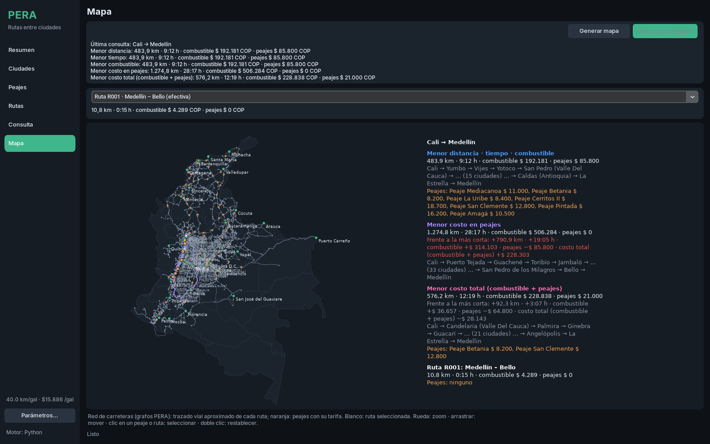

# Parcial 3 · PERA — route graphs of Colombia

Part of [Grafos](../README.md). *Programa Estadístico de Rutas de Automóviles*: distances, fuel and toll costs between Colombian cities, on weighted graphs. A C++17 engine (`pera_cpp --api`, plus a console with a statistical summary) and a CustomTkinter window (dashboard, editable tables, queries, offline map) with a standalone Python engine.



## Video

[PERA walkthrough](docs/video_parcial3.mp4) (Spanish narration, burned-in subtitles).

## Run

```bash
python3 -m venv .venv && .venv/bin/pip install -r requirements.txt
.venv/bin/python src/python/Parcial3_REMR.py
cmake -S . -B build -DCMAKE_BUILD_TYPE=Release && cmake --build build && ./build/pera_cpp   # console
```

Flags: `--python-backend`, `--cpp-binary PATH`, `--data FILE`. Windows: `Iniciar PERA.pyw` (prebuilt `bin/windows/pera_cpp.exe`, SHA-256 alongside).

## Data

`data/pera_colombia.csv` (format "PERA v1") is built reproducibly from open data: 1,070 nodes, 2,453 road links, 148 tolls. See [`data/README.md`](data/README.md) for sources, assumptions and limits.

```bash
python3 scripts/build_data.py        # needs network the first time (cached afterwards)
python3 scripts/build_geometry.py    # road shapes and borders used only for drawing
python3 scripts/validate_data.py
```

## Layout

| Path | Content |
|---|---|
| `src/cpp/Parcial3_REMR.cpp` | graphs, Dijkstra, statistics, JSON API, console |
| `src/python/` | engine, backend adapter, window (`ui/`), road-network and locality routing |
| `data/` | dataset, locality and toll catalogues, offline map assets (`vendor/`, borders, road shapes) |
| `docs/especificacion_tecnica.docx` | technical specification (Spanish) with UML and real screenshots |
| `scripts/` | data build, validation, spec generation, screenshot capture |

## Tests

```bash
ctest --test-dir build
python3 tests/integration/check_interop.py build/pera_cpp data/pera_colombia.csv
PYTHONPATH=src/python python3 -m unittest discover -s tests/python
```

Window tests need `PERA_VIRTUAL_DISPLAY=1` and a virtual `DISPLAY`.
