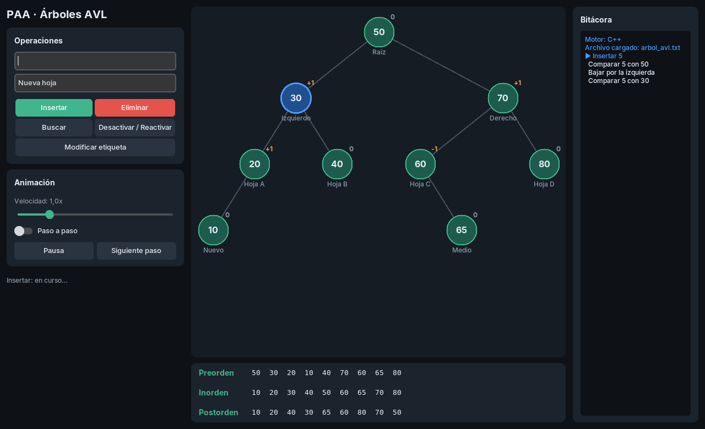
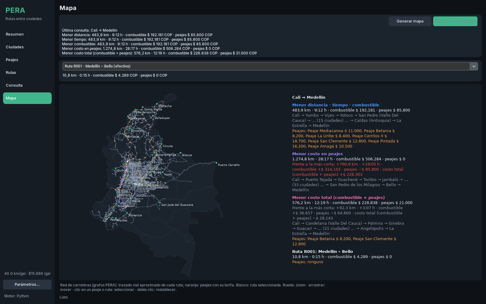
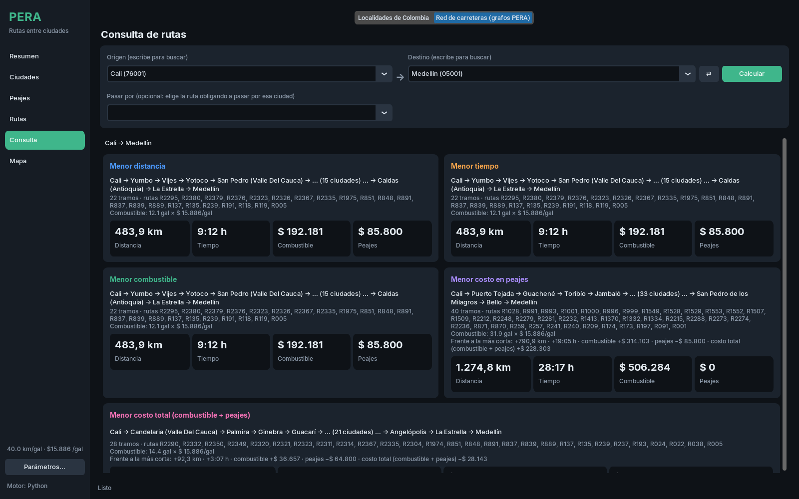
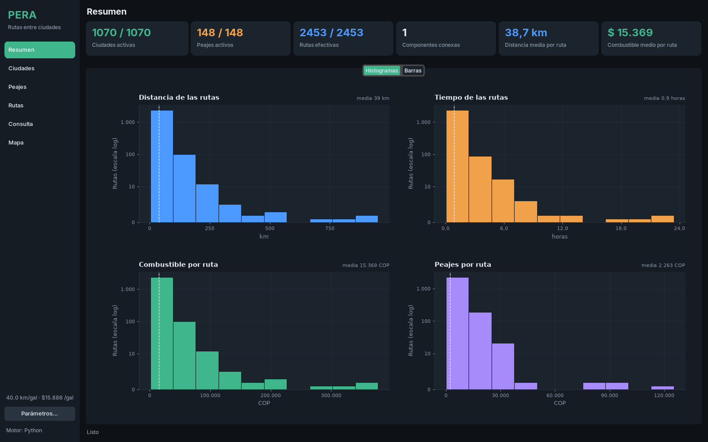
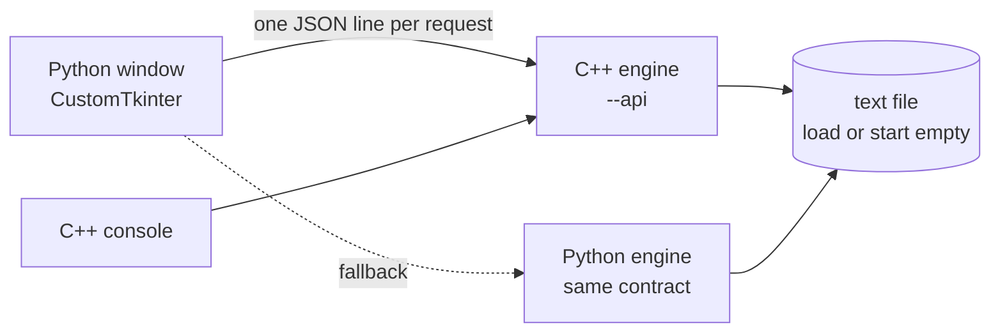

<div align="center">


# Grafos

**Two data-structures assignments in one repo: an animated AVL tree teacher and a road-route model of Colombia.**
Each program is a C++17 engine plus a Python desktop window that also works on its own.

[Taller 3 · PAA (AVL)](#taller-3--paa-avl-trees) ·
[Parcial 3 · PERA (route graphs)](#parcial-3--pera-route-graphs) ·
[Quick start](#quick-start) ·
[Troubleshooting](#troubleshooting) ·
[Credits](#credits)


</div>

> The programs, their on-screen text and the technical specifications are in **Spanish** (the course is taught at Universidad Popular del Cesar). This README is in English.

## Screenshots

<table>
<tr>
<td width="50%"><br><sub><b>PAA</b> animates every comparison and rotation of an AVL insertion.</sub></td>
<td width="50%"><br><sub><b>PERA</b> offline map: road network, tolls with tariffs, and the queried routes.</sub></td>
</tr>
<tr>
<td><br><sub>One query, five optimal paths (distance, time, fuel, tolls, total cost).</sub></td>
<td><br><sub>Dashboard with histograms and bar charts.</sub></td>
</tr>
</table>

## Features

**Taller 3 · PAA (AVL trees)**
- Insert, delete, search, deactivate/reactivate and relabel nodes of an AVL tree.
- Step-by-step animation: comparisons, heights, balance factors and the four rotations (LL, RR, LR, RL), with speed control and a pause / next-step mode.
- Pre-order, in-order and post-order traversals, an action log and undo (Ctrl+Z).
- Load-or-start-empty persistence in a plain text file.

**Parcial 3 · PERA (route graphs)**
- A real road network of **1,070 nodes** (every municipal seat in Colombia with a driving road, capitals included), **2,453 road links** and **148 tolls**, from open data.
- Five optimal paths per query, each a Dijkstra over its own weighted graph: shortest distance, shortest time, least fuel, least toll cost and least **total** cost (fuel + tolls). Totals for all four quantities are shown for each path.
- "Pass through" a chosen city to pick the road you want; every alternative is compared with the shortest route.
- A second query mode over **8,420 Colombian populated places** (veredas and centros poblados included) (DANE catalogue) using the OSRM routing service, with selectable route alternatives, a via point and an offline cache of the last answers.
- Fully editable data (create, edit, deactivate, delete, undo) for cities, tolls and routes, with validation.
- Python dashboard (histograms, bar charts) and a C++ console summary, as the assignment asks.
- Interactive offline map (zoom, pan, click to select) plus an optional self-contained Folium HTML export.

## Videos

- [**PAA: AVL trees**](Taller3/docs/video_taller3.mp4) (Taller 3, about 5.5 min): the node and the balance rule, the four rotations, deletion, the two engines and the real app.
- [**PERA: route graphs**](Parcial3/docs/video_parcial3.mp4) (Parcial 3, about 4.8 min): real data, the model, Dijkstra, five optimal paths, the programs and the map.

Narration is in Spanish with burned-in subtitles.

## How it works



The window talks to the C++ engine through a one-line-JSON protocol on stdin/stdout. If the binary is missing it falls back to an equivalent Python engine, and both are checked against each other by an interoperability test that replays the same requests and compares every response. Each engine also runs on its own.

## Requirements

- Python 3.10 or later with Tk (`customtkinter`; `matplotlib` and `folium` for PERA, see each `requirements.txt`).
- Optional: a C++17 compiler and CMake to build the engines. A prebuilt 64-bit Windows executable is included under `bin/windows/` with its SHA-256.
- Internet is only needed for PERA's *Localidades de Colombia* mode (route service) and for the optional online base map.

## Quick start

```bash
git clone https://github.com/nxmxl3zz/Grafos.git
cd Grafos
python3 -m venv .venv && .venv/bin/pip install -r Parcial3/requirements.txt
.venv/bin/python Parcial3/src/python/Parcial3_REMR.py      # PERA
.venv/bin/python Taller3/src/python/Taller3_REMR.py        # PAA
```

On Windows, double-click `Iniciar PERA.pyw` or `Iniciar PAA.pyw` inside each project folder.

## Detailed setup

Build and test each engine (from inside `Taller3/` or `Parcial3/`):

```bash
cmake -S . -B build -DCMAKE_BUILD_TYPE=Release
cmake --build build
ctest --test-dir build                      # C++ self-test and API check
python3 tests/integration/check_interop.py build/<paa_cpp|pera_cpp> data/<file>
PYTHONPATH=src/python python3 -m unittest discover -s tests/python
```

The window tests open real windows, so they are skipped unless you declare a virtual display: `PERA_VIRTUAL_DISPLAY=1 DISPLAY=<virtual> python3 -m unittest discover -s tests/python`.

## Usage

| | PAA (Taller 3) | PERA (Parcial 3) |
|---|---|---|
| Window | `src/python/Taller3_REMR.py` | `src/python/Parcial3_REMR.py` |
| C++ console | `build/paa_cpp` | `build/pera_cpp` |
| Data file | `data/arbol_avl.txt` | `data/pera_colombia.csv` |
| Flags | `--python-backend`, `--cpp-binary PATH`, `--data FILE` | same |

PERA tabs: **Resumen** (dashboard), **Ciudades**, **Peajes**, **Rutas** (editable tables), **Consulta** (two modes: *Localidades de Colombia* and *Red de carreteras*) and **Mapa**. **Parámetros…** sets fuel consumption (with vehicle presets), gallon price and default speed.

## Configuration

- Fuel model: `km ÷ consumption × price`. Defaults are 40 km/gal and 15,886 COP/gal (a November 2026 reference average, not a live price); both are editable.
- Tolls are INVIAS **category I** (cars). The graph dataset only contains tolls with a published tariff; in the place-search mode, tolls without one stay *unknown* (never zero) and the total is flagged as partial.
- `PERA_CACHE` overrides the folder where route answers are cached.
- Rebuild the dataset with `scripts/build_data.py`, then `scripts/build_geometry.py`; validate with `scripts/validate_data.py`. Provenance and limits are in [`Parcial3/data/README.md`](Parcial3/data/README.md).

## Troubleshooting

- **`ModuleNotFoundError: customtkinter`** – install it in a virtual environment (`pip install -r requirements.txt`); on distributions that block system-wide `pip` (PEP 668) a venv is required.
- **The window says "Motor: Python"** – the C++ binary was not found. Build it (see above) or ignore it: the Python engine is equivalent.
- **"No path registered"** – the network only contains the roads in the dataset; a missing path does not prove a trip is physically impossible.
- **Localidades mode fails** – it needs internet. Previously answered queries are reused offline and flagged as such.
- **Windows executable** – it is cross-compiled and has not been run on Windows by the author; tell me if it misbehaves.

## Credits

Built by Rafael Miranda ([@nxmxl3zz](https://github.com/nxmxl3zz)) for *Estructura de Datos*, Universidad Popular del Cesar (2026-2).

Data and components: [OSRM](https://project-osrm.org/) routing on © [OpenStreetMap](https://www.openstreetmap.org/copyright) contributors; tolls from INVIAS and ANI open data ([datos.gov.co](https://www.datos.gov.co)); populated places from DANE DIVIPOLA; coordinates from Wikidata; department borders from [Natural Earth](https://www.naturalearthdata.com/) (public domain); maps with [Leaflet](https://leafletjs.com/) and [Folium](https://python-visualization.github.io/folium/); UI with [CustomTkinter](https://github.com/TomSchimansky/CustomTkinter) and Matplotlib.

## License

[MIT](LICENSE) © 2026 Rafael Miranda.
