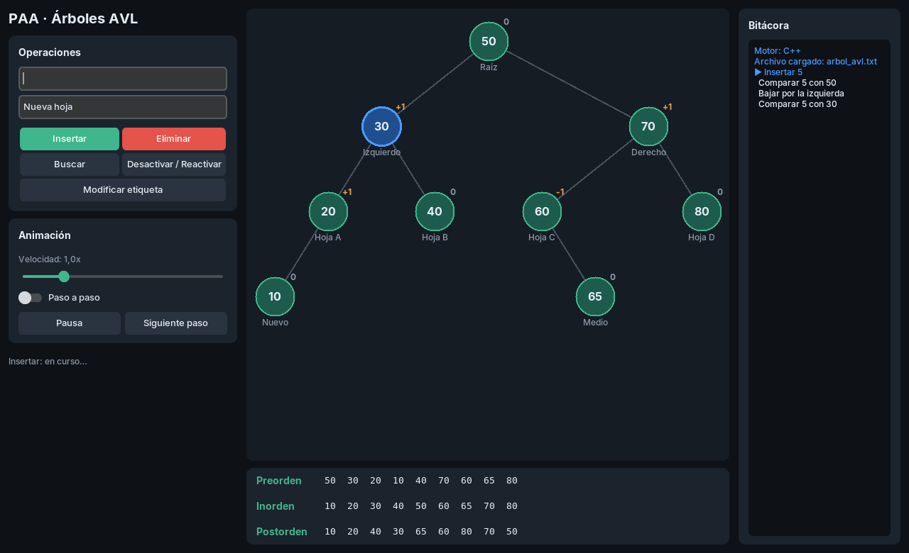

# Taller 3 · PAA — AVL trees

Part of [Grafos](../README.md). An animated teacher for AVL trees: a C++17 engine (`paa_cpp --api`, also an interactive console) and a CustomTkinter window with its own standalone Python engine.



## Video

[PAA walkthrough](docs/video_taller3.mp4) (Spanish narration, burned-in subtitles).

## Run

```bash
python3 -m venv .venv && .venv/bin/pip install -r requirements.txt
.venv/bin/python src/python/Taller3_REMR.py            # window (uses build/paa_cpp if present)
cmake -S . -B build -DCMAKE_BUILD_TYPE=Release && cmake --build build && ./build/paa_cpp   # console
```

Flags: `--python-backend`, `--cpp-binary PATH`, `--data FILE`. Windows: double-click `Iniciar PAA.pyw` (prebuilt `bin/windows/paa_cpp.exe`, SHA-256 alongside).

## Layout

| Path | Content |
|---|---|
| `src/cpp/Taller3_REMR.cpp` | AVL engine, JSON API and console |
| `src/python/` | window, animation player and the standalone Python engine |
| `data/arbol_avl.txt` | persistence file (`key;label;active`, pre-order) |
| `docs/especificacion_tecnica.docx` | technical specification (Spanish) with UML |
| `tests/` | engine, window and C++/Python interoperability tests |

## Tests

```bash
ctest --test-dir build
python3 tests/integration/check_interop.py build/paa_cpp data/arbol_avl.txt
PYTHONPATH=src/python python3 -m unittest discover -s tests/python
```

Window tests need `PERA_VIRTUAL_DISPLAY=1` and a virtual `DISPLAY`. Screenshots: `scripts/capture_screens.py`.
